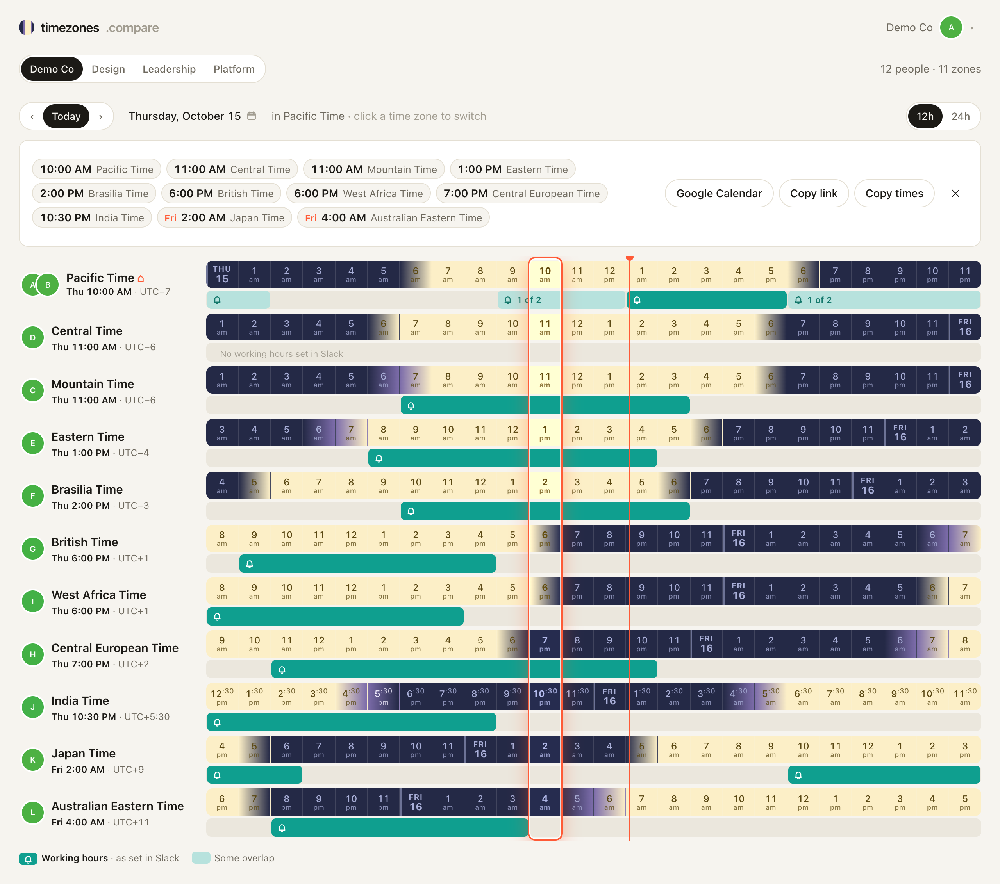

# timezones.compare

See where your coworkers' days overlap. Like [World Time Buddy](https://www.worldtimebuddy.com/), but the rows are people, and their time zones come straight from Slack, so nobody maintains a list.



- **One row per time zone.** Coworkers who share a zone share a row.
- **Real daylight, not "business hours."** Each row is shaded by actual sunrise, sunset, and twilight for that zone. Night owls are welcome.
- **Working hours, from Slack.** A band under each row shows the working hours each person set in Slack (Preferences › Availability, where Slack only notifies them during those hours). It updates by itself, and there's no separate setting here. There is no extra setting to maintain.
- **Compare and schedule.** Point at any hour to see it everywhere. Click to pin it, then open a Google Calendar invite with the board's people as guests, or copy the times grouped by zone with names.
- **Boards come from Slack.** Everyone signs in and sees an Everyone board plus a board for each Slack user group they're in. Nothing to curate.

## How it works

You sign in with Slack. The app asks for **user-token scopes only**, so it needs no workspace admin and no bot:

| Scope | Used for |
| --- | --- |
| `users:read` | Names, avatars, and time zones for your workspace |
| `users:read.email` | Work emails, so a pinned hour can open a Google Calendar invite with the board's people as guests |
| `dnd:read` | Each person's working hours |
| `usergroups:read` | Slack user groups, each shown as a 👥 board |
| `channels:read` | Public channels (names, sizes, members), each shown as a # board |

There's nothing to set up. Your **Everyone** board is every colleague in the workspace, leaving out guests and bots. You also get one board per Slack user group you're in, like @mobile-team or @leadership. Boards follow Slack: people who join, leave, or change groups update on the next sync.

Your token syncs the whole roster into a shared cache for your workspace. Background refreshes borrow the token of whoever signed in most recently. If Slack rejects a token, it is discarded and the next person's is used. Your coworkers never have to sign in for you to see them.

**What's stored:** names, work emails, avatars, time zones, working hours, and user group membership. Emails are only used to fill in calendar guests, and are only visible to people in the same workspace. Never messages, channels, or files. Slack tokens are encrypted at rest with Active Record Encryption.

Some workspaces require an admin to approve new Slack apps. That's a Slack setting; the app itself has no admin role.

## Run it locally

Requires Ruby 4.0 (see `.ruby-version`). No Node, no Docker.

```sh
bin/setup
FAKE_SLACK=1 bin/dev
```

Open http://localhost:3000 and click **Try the demo**. You'll be signed in as a seeded person, with a board of coworkers across eleven zones.

To sign in with real Slack locally, Slack needs an HTTPS redirect URL. Run a tunnel (for example `ngrok http 3000`), add `https://<tunnel>/auth/slack/callback` to your Slack app's redirect URLs, copy `.env.example` to `.env`, fill in the Slack credentials, remove `FAKE_SLACK`, and open the tunnel URL.

```sh
bin/rails test
```

## Create the Slack app

1. Go to https://api.slack.com/apps?new_app=1 and choose **From an app manifest**.
2. Paste [`slack-manifest.yml`](slack-manifest.yml), replacing `YOUR-HOST` with your domain.
3. Copy the **Client ID** and **Client Secret** from **Basic Information**.
4. To let other workspaces use your instance, enable **Manage Distribution**. For a single company, skip this.

## Deploy to Fly

The app is one machine with SQLite on a volume. The database, background jobs (Solid Queue), and cache all live in that one volume.

```sh
fly apps create your-app-name   # then set `app` in fly.toml to match
fly volumes create data --size 1 --region sjc
fly secrets set SECRET_KEY_BASE=$(bin/rails secret) SLACK_CLIENT_ID=... SLACK_CLIENT_SECRET=...
fly deploy
```

For a custom domain, run `fly certs add your.domain` and update the Slack redirect URL.

Backups are worth setting up: [Litestream](https://litestream.io/) can stream the SQLite files in `/rails/storage` to S3 or R2.

## Self-host elsewhere

The `Dockerfile` is the standard Rails 8 production image. Run it anywhere with a persistent volume mounted at `/rails/storage`, the same three secrets, and `SOLID_QUEUE_IN_PUMA=true`.

## Adding another source

Slack is the only source today. Google Calendar and Microsoft 365 are natural next ones. See [`docs/sources.md`](docs/sources.md).

## License

MIT
